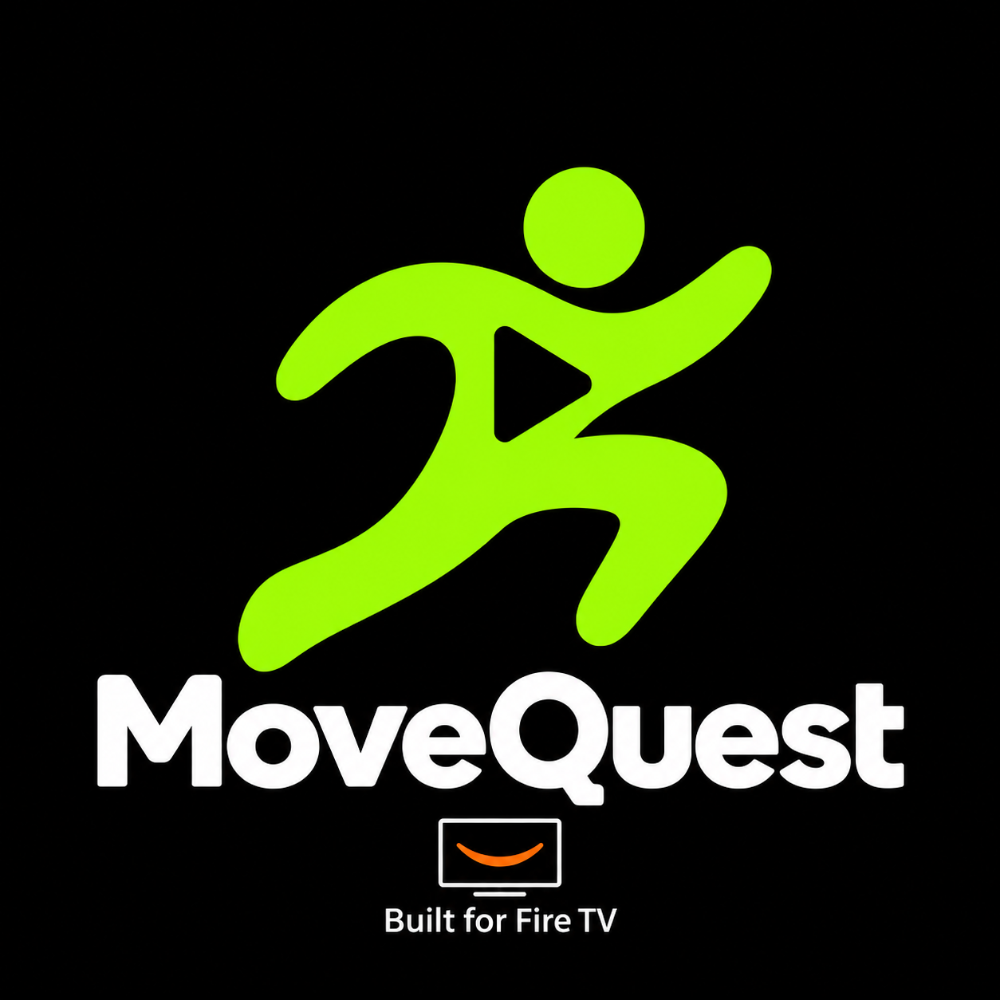

<p align="center">
  
</p>

# MoveQuest TV

MoveQuest is a React Native fitness and family game app for Fire TV. A phone provides the local IP camera and optional microphone-based command input; the Fire TV receives an MJPEG stream and runs pose/hand inference, rep counting, gesture actions, and the experience UI on the TV. Frames stay on the local Wi‑Fi network and are not uploaded to a cloud service.

> MoveQuest is a hackathon prototype. Exercise scoring is heuristic and is not medical advice. Camera streaming currently expects the phone and TV to be on the same trusted Wi‑Fi network.

## Quick start

1. Install Node.js, Android Studio, and the Android SDK/platform tools. Open a terminal at the repository root.
2. Install the TV app dependencies and build the standalone APK:

   ```powershell
   cd apps/tv
   npm ci
   cd android
   .\gradlew.bat assembleRelease
   ```

3. Install `apps/tv/android/app/build/outputs/apk/release/app-release.apk` on a Fire TV device with ADB enabled (instructions below).
4. Install and launch the phone companion, start its camera stream, then enter its displayed `/video` URL in the TV app.

For emulator development and phone app setup, see [Android Studio](#run-the-tv-app-in-android-studio-android-tv-emulator) and [Phone companion](#phone-companion). Contributor workflow and checks are in [CONTRIBUTING.md](CONTRIBUTING.md).

## Workspace

- `apps/tv`: Fire TV React Native app, workout/game screens, native MediaPipe inference, and MJPEG receiver.
- `apps/phone`: phone camera-stream app that serves a local MJPEG endpoint (no inference on the phone).
- `packages/game-kit`: shared exercise scoring and event types.

## Current prototype

### Guided activities and voice

All six activities are available from the home screen. Select an activity, read or listen to its instructions, then select **START SESSION**. Workout time advances once camera frames arrive, even while the player adjusts position. Visible joints are required for counting, not for running the clock. Pause, missing frames, or losing a player clears unfinished movement cycles; session totals remain recorded.

- **Squats:** start standing, lower with control, hold briefly, then return to standing. Pose checks use knee angles, left/right consistency and torso lean. Turn slightly sideways, with both legs visible.
- **Jumping jacks:** start with hands down and feet together, open arms and feet, then fully close. Both arms and legs must complete the cycle.
- **Arm raises:** start with hands down, raise both hands overhead, then lower fully. Reach and symmetry checks provide cues.
- **Freeze Dance:** move for six seconds, then freeze for four. Each tracked player earns a point for a round with observed dancing followed by stillness. An initial transition grace period avoids penalizing the response to a freeze cue.
- **Mimic the Pose:** alternate a sideways T pose and both hands overhead; hold the target continuously for two seconds to earn a point.
- **Gesture Trivia:** five questions with left/right choices. Swipe to choose and hold a pointing-up sign to confirm, or select the on-screen remote buttons. Each question scores only once.

These are MediaPipe pose estimates and transparent gameplay rules, not a trained clinical form assessor. Only complete start–movement–return workout cycles count; obscured joints and detected form problems can reject a cycle. Counts and cues need real-device validation across camera positions, bodies and lighting.

**COACH VOICE** toggles spoken instructions, counts and corrective cues through the TV's installed text-to-speech engine. **VOICE COMMAND** listens for one command: `squats`, `jumping jacks`, `arm raises`, `freeze dance`, `mimic the pose`, `gesture trivia`, `pause`, `resume`, `finish`, `home`, `repeat instructions`, `left`, `right`, or `confirm`. Activity commands open the instructions screen. Recording is user-initiated and time-limited; scoring and time wait while listening. Microphone permission and a compatible Android speech service are required. The app prefers on-device recognition where available. Otherwise the system speech provider may use a network service. Some Fire TVs expose neither app speech recognition nor their Alexa remote microphone to third-party apps; the UI reports this and all actions remain available by remote. Spoken output also requires an installed TTS engine and English voice data.

The last successfully connected camera URL is saved on the TV. The input fills `/video` for a bare camera address and uses HTTP for the local companion stream.

After selecting an activity by voice, select **VOICE COMMAND** again and say `start session` to begin from its instructions screen.

Run scoring regressions after installing TV dependencies:

```powershell
node --test tests/coach.test.cjs
```

Use JDK 21 for the Android build; Java 25 can cause Android Prefab configuration to fail. For a Fire TV APK containing both ARM variants:

```powershell
cd apps/tv/android
.\gradlew.bat assembleRelease '-PreactNativeArchitectures=armeabi-v7a,arm64-v8a'
```

The TV app uses MediaPipe Pose Landmarker Lite and Gesture Recognizer models and runs inference on decoded phone-camera frames. It estimates squat, jumping-jack, and arm-raise reps, tracks up to four temporary player slots, and shows camera preview and movement feedback on the TV. Counts/form are prototype heuristics, not medical guidance. This implementation samples the stream rather than processing every camera frame; actual speed depends on the Fire TV model and Wi‑Fi.

The phone app provides `http://<phone-ip>:8080/video` as an MJPEG stream. The TV app connects directly to that URL and performs all model inference. The release build includes the Android ABIs configured by Gradle; use Android Studio to build the emulator version as described below.

## TV launcher and accessibility

The TV app uses the MoveQuest lime-on-charcoal icon for its launcher identity and a dedicated Android TV/Fire TV banner. The app name is **MoveQuest TV**. If you regenerate Android native files from Expo, keep the icon configuration in `apps/tv/app.json` and re-apply the `android:banner` entry in `apps/tv/android/app/src/main/AndroidManifest.xml` (or add it to the project's config plugin) so the TV launcher banner is retained.

Primary controls and activity cards expose screen-reader roles, names, and hints. The interface is navigable with a remote D-pad, highlights focused controls, and announces camera connection and workout feedback updates. For an accessibility check, enable TalkBack in Android TV's accessibility settings where available and verify every action can be focused and activated with D-pad/Select; the phone-camera URL field may require the on-screen keyboard.

## Fire TV setup

Install Node.js, Android Studio, Android SDK Platform Tools, and enable Developer Options plus ADB Debugging on the Fire TV. Keep the phone and development computer on the same Wi-Fi network.

Enable Developer Options and ADB Debugging on Fire TV, connect the Fire TV and phone to the same Wi-Fi, and install the TV APK:

```powershell
adb connect <fire-tv-ip>:5555
adb devices -l
adb install apps/tv/android/app/build/outputs/apk/release/app-release.apk
```

On the Android phone, enable Developer Options and USB debugging, connect it to the development computer, and install the camera-stream app (use `adb devices -l` to confirm the phone is listed):

```powershell
adb -d install apps/phone/android/app/build/outputs/apk/release/app-release.apk
```

Alternatively, copy the phone APK to the phone and tap it to install. Open **MoveQuest Companion**, grant camera access, and tap **START CAMERA STREAM**. Find the phone’s Wi‑Fi IP in Android **Settings → Wi‑Fi → connected network**; enter it in the phone app. On the TV home screen, enter the displayed URL `http://<phone-ip>:8080/video` and select **CONNECT CAMERA**. Both devices must share Wi‑Fi. Then choose a workout/game on the TV. Keep the phone app open in the foreground and frame the full body in a well-lit area. A third-party IP camera app can also be used if it exposes a local multipart MJPEG URL (commonly `/video`).

## Run the TV app in Android Studio (Android TV emulator)

Use an emulator to check the TV layout and D-pad navigation without a Fire TV. It does not emulate the phone camera or replace testing on Fire TV hardware.

1. Install Node.js and Android Studio. From a terminal at the repository root, install the TV app's JavaScript dependencies:

   ```powershell
   cd apps/tv
   npm install
   ```

2. In Android Studio, choose **Open** and select `apps/tv/android` (not the repository root). Let Gradle sync finish. If asked, install the Android SDK/platform and build tools required by the project; it compiles against API 36. Android Studio/Gradle must be able to find `node` on its PATH because the build invokes Expo and React Native tooling.

3. Create an Android TV virtual device: open **Tools > Device Manager** (or **More Actions > Virtual Device Manager** from the welcome screen), click **Create Device**, select a TV/Android TV hardware profile, then select an available x86_64 Android system image and finish creating the AVD. If offered, enable host GPU/hardware graphics acceleration.

4. Start the TV emulator from Device Manager. In Android Studio's toolbar, choose the `app` run configuration and the emulator as the deployment target, then click **Run ▶**. Android Studio builds the debug app for that emulator and installs/launches it. Use the emulator remote controls or keyboard arrow keys and Enter to test D-pad focus and selection.

The release APK at `apps/tv/android/app/build/outputs/apk/release/app-release.apk` is built for 32-bit ARM Fire TV hardware, so it is not the APK to install on an x86_64 emulator. Run the source project from Android Studio so Gradle builds for the selected emulator. Test the phone-camera workflow with the phone companion and a real Fire TV on the same Wi-Fi; the emulator instructions are for TV UI and remote-navigation checks. See [Android TV emulator setup](https://developer.android.com/training/tv/get-started/create) and [Android Studio Device Manager](https://developer.android.com/studio/run/managing-avds).

## Phone companion

For development with an Android phone connected over USB with USB debugging enabled, run:

```powershell
cd apps/phone
npm install
npx expo run:android
```

This builds, installs, and launches the development app; keep the Metro bundler running while using it. To rebuild the standalone, Metro-free APK from the repository root:

```powershell
cd apps/phone/android
.\gradlew.bat assembleRelease
```

The release APK is written to `apps/phone/android/app/build/outputs/apk/release/app-release.apk`. This is the camera-stream and optional voice-command app; it does not bundle or execute MediaPipe. The TV APK contains the pose and gesture models and native inference code.

In an active session, hold a Victory sign to pause/resume and lower your hand before repeating it. Thumbs down pauses for a rest; thumbs up and the I Love You sign provide encouragement. For Gesture Trivia, swipe left/right to select, then hold pointing up to confirm. Open palms and closed fists do not toggle pause because they occur naturally during exercise. Gestures control MoveQuest only, not YouTube or other Fire TV apps.

## Privacy

The phone streams camera images directly to the TV over local Wi‑Fi. Pose and gesture models run on the TV. No camera images, video, identity data, or scores are uploaded to a cloud service by this prototype. Use only on a trusted local network.

Optional voice commands use the installed Android speech service. The app uses an on-device recognizer when available; a fallback system recognizer may send audio to its provider. The UI identifies this mode before listening. Voice recording starts only after selecting **VOICE COMMAND**, requires permission, and stops after one result, an error, a timeout, or leaving the app.

### Camera orientation and low-powered Fire TVs

The TV reads JPEG EXIF orientation before inference, then searches for an upright torso if needed. ROTATE CAMERA rotates both the preview and model input together in 90-degree steps; the choice is saved. AUTO ORIENTATION restores automatic detection. Keep the whole body in view during orientation detection.

Camera reading and inference run independently with a single latest-frame mailbox, so slow inference does not queue old video. Live inference uses the official [MediaPipe Pose Landmarker Lite model](https://developers.google.com/edge/mediapipe/solutions/vision/pose_landmarker). Gesture inference is sampled separately. The UI shows inference time, and player tracks tolerate up to six seconds between results. Side-view squats can use one clearly visible leg. A full cycle can count when a slow camera captures just one frame in the active position; implausibly fast spikes, missing joints and unfinished movements still do not count.

### Voice fixes for Fire TV

Install both updated APKs for the complete voice path. The TV bundles 99 offline spoken clips and can compose rep counts, game-point announcements and session summaries without an installed Android TTS engine. Bundled audio is the default for known coaching phrases and counts; the system voice is used only for unlisted text, and playback errors fall back to available clips. Select TEST COACH VOICE to verify media sound. Keep COACH VOICE enabled and raise the TV media volume if needed.

Some Fire TVs do not expose an Android recognizer or the Alexa remote microphone to apps. In that case, use SPEAK TV COMMAND in the updated phone companion while the camera stream is connected. Grant microphone permission and say a supported command (for example pause, resume, squats, start session or home). The phone asks its installed speech provider to recognize one utterance, then forwards only the recognized command text with a camera frame over local Wi-Fi. It does not stream microphone audio to the TV. The phone speech provider may use its network service; a typed SEND TEXT COMMAND fallback is also available. Commands expire after ten seconds and the TV accepts only its explicit command phrases. The phone must remain open, and an updated phone APK is required.

To regenerate spoken assets on Windows, install TV dependencies, run `node scripts/prepare-coach-audio.cjs`, then `./scripts/synthesize-coach-audio.ps1`. Synthesis uses the installed Windows speech voice offline. Run `node --test tests/voice.test.cjs` from the repository root to verify clip content and command relay behavior.
